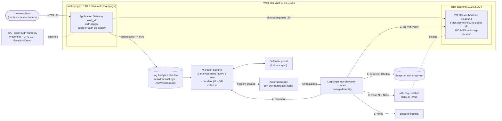
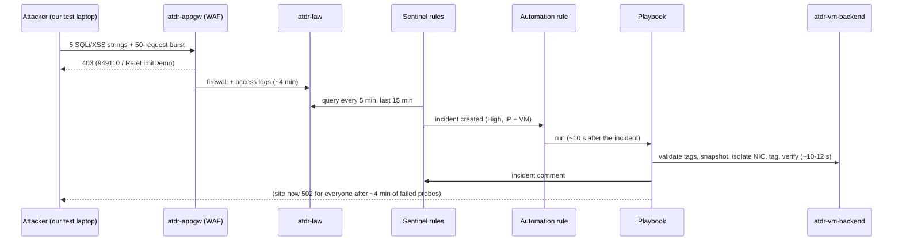

# Architecture

Everything is in one resource group, **`rg-atdr`**, in **Central India**, on an
Azure for Students subscription. Every resource is tagged `Project=ATDR`.

## Sequence of one attack

## Components

| Component | Name | Configuration | Script |
|---|---|---|---|
| Virtual network | `atdr-vnet` | 10.10.0.0/16; `snet-appgw` 10.10.1.0/24, `snet-backend` 10.10.2.0/24 | `infra/01-foundation.sh` |
| NSG (gateway subnet) | `atdr-nsg-appgw` | Internet → 80; GatewayManager 65200–65535; AzureLoadBalancer | 01 |
| NSG (backend NIC) | `atdr-nsg-backend` | 80 from 10.10.1.0/24 only; AzureLoadBalancer; deny all else | 01 |
| NSG (isolation) | `atdr-nsg-isolation` | deny all inbound and outbound (priority 100) | 01 |
| Backend VM | `atdr-vm-backend` | Ubuntu 24.04, Standard_B2ats_v2, StandardSSD 30 GB, no public IP, tags `Role=TestBackend` | 01, `02-deploy-webapp.sh` |
| Web app | ATDR Demo Portal | Flask + gunicorn on :80, systemd hardening, JSON access log | `webapp/` |
| Log Analytics + Sentinel | `atdr-law` | PerGB2018, 30-day retention, 1 GB/day cap; Sentinel onboarded; Defender portal primary | 01 |
| WAF policy | `atdr-wafpolicy` | Prevention, Microsoft_DefaultRuleSet 2.1, `RateLimitDemo` (20/min per client, `RequestUri` begins with `/`) | `infra/04a-waf-policy.sh` |
| Application Gateway | `atdr-appgw` + `atdr-pip-appgw` | WAF_v2, autoscale 0–2 (minimum maximum is 2), HTTP :80, probe `GET /health` every 30 s, diagnostics → atdr-law (resource-specific) | `infra/04-appgw-create.sh` / `-delete.sh` |
| Analytics rules | 2 scheduled rules | 5 min / 15 min, entities IP + AzureResource, grouping by IP, 15-min suppression | `detection-live/deploy-rules.sh` |
| Automation rule | run atdr-playbook-contain | incidents created by either ATDR rule; **off between sessions** | `detection-live/automation-rule.sh` |
| Playbook | `atdr-playbook-contain` (+ connection `atdr-conn-sentinel`) | Logic App Consumption, Sentinel incident trigger, managed identity, ARM calls via HTTP | `response/deploy-playbook.sh` |

## Identities and permissions (all scoped to rg-atdr)

| Principal | Role | Why |
|---|---|---|
| Playbook managed identity | Microsoft Sentinel Responder | comment on incidents |
| | Network Contributor | swap the NIC's NSG |
| | Virtual Machine Contributor | read and tag the VM |
| | Disk Snapshot Contributor | create the snapshot |
| Azure Security Insights (Sentinel service) | Microsoft Sentinel Automation Contributor | lets the automation rule start the playbook |
| Aayush (guest) | Microsoft Sentinel Contributor | work with the Sentinel rules and incidents (no Owner/Contributor) |
| Third teammate (guest) | Reader + Microsoft Sentinel Reader | view the portal for the demo |

There are no keys or passwords in the repository. The Discord webhook URL is
passed only as a secure deployment parameter, from the environment variable
`NOTIFY_WEBHOOK_URL`.
